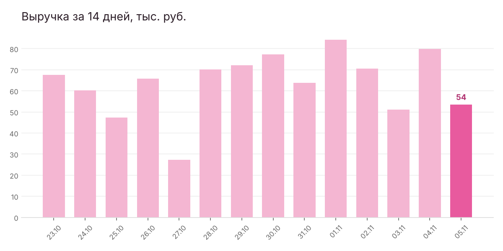

# 📊 Sheets Report Bot

Telegram-бот, который берёт данные о продажах из Google Таблицы и присылает понятную сводку:
выручку за день с динамикой, заказы и средний чек, выполнение плана месяца с прогнозом,
топ товаров и что заканчивается на складе. Каждое утро отчёт приходит сам, а по кнопкам —
в любой момент.



## Что умеет

- **Ежедневный отчёт по расписанию** — в заданное время в нужный чат, с графиком выручки за 14 дней
- **Кнопки:** «Отчёт за вчера», «Остатки», «План месяца»
- **План и прогноз:** сколько выполнено и чем закончится месяц при текущем темпе
- **Остатки:** список товаров, которых меньше порога
- **Без ключей Google Cloud:** таблица читается по ссылке с доступом на просмотр
- Устойчив к «русским» форматам: даты `04.11.2026`, суммы `1 290,50`

## Формат таблицы

Лист **«Продажи»**: `Дата | Товар | Количество | Сумма` — одна строка = один заказ.
Лист **«Остатки»**: `Товар | Остаток`.

Пример с данными вымышленного магазина — `demo_data/demo_shop.xlsx`
(сгенерирован скриптом `make_demo_data.py`).

## Запуск

```bash
python -m venv .venv && source .venv/bin/activate
pip install -r requirements.txt
cp .env.example .env      # токен бота, ID таблицы, ваш chat_id
python bot.py
```

На сервере бот запускается как служба systemd и работает круглосуточно.

## Стек

Python · pandas · matplotlib · Telegram Bot API · Google Sheets (CSV-выгрузка) · systemd · pytest
